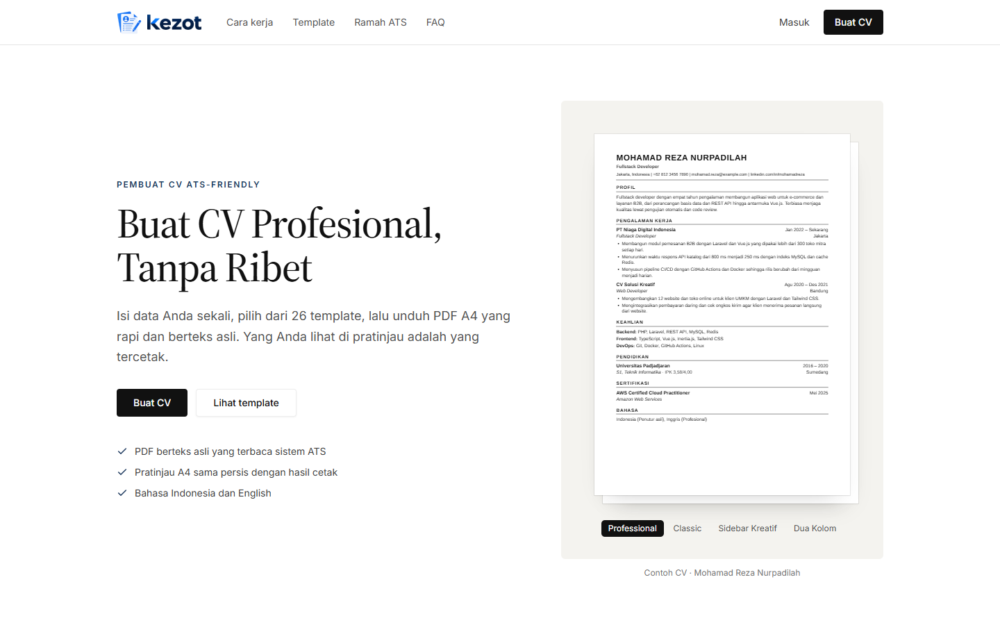
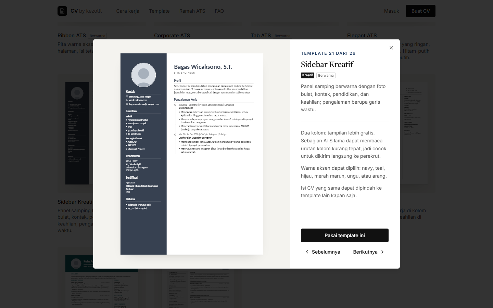
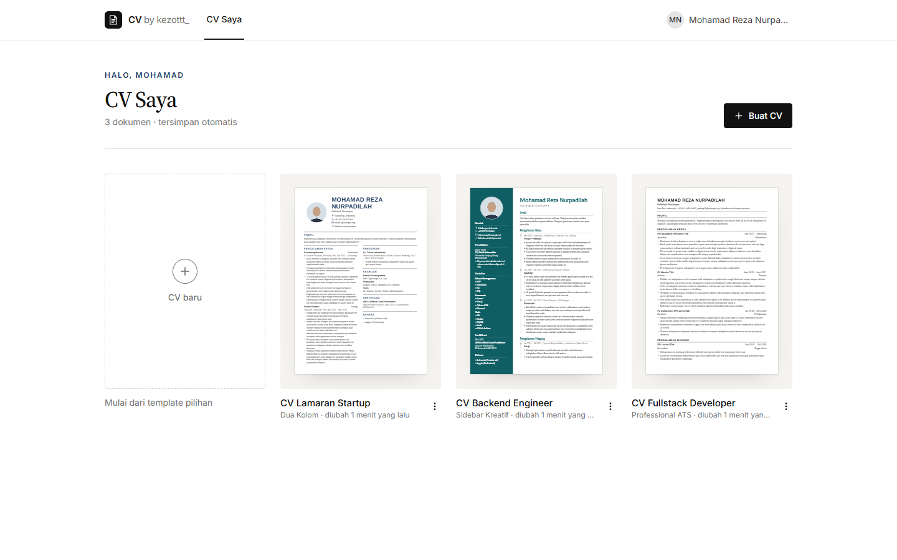
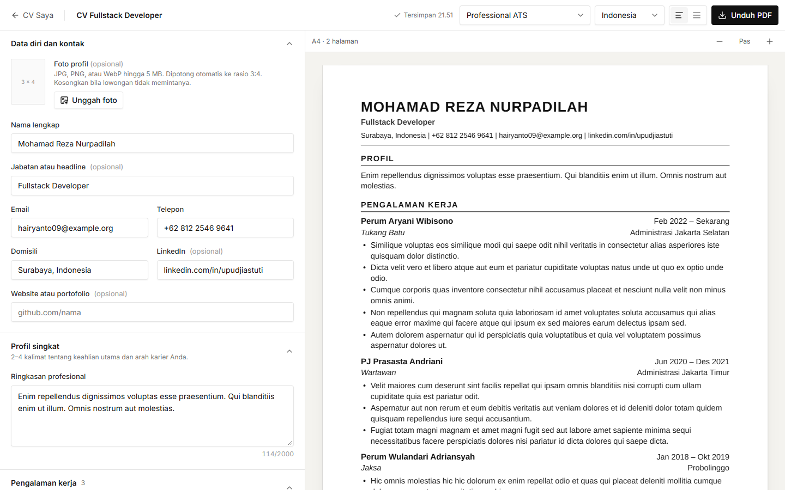
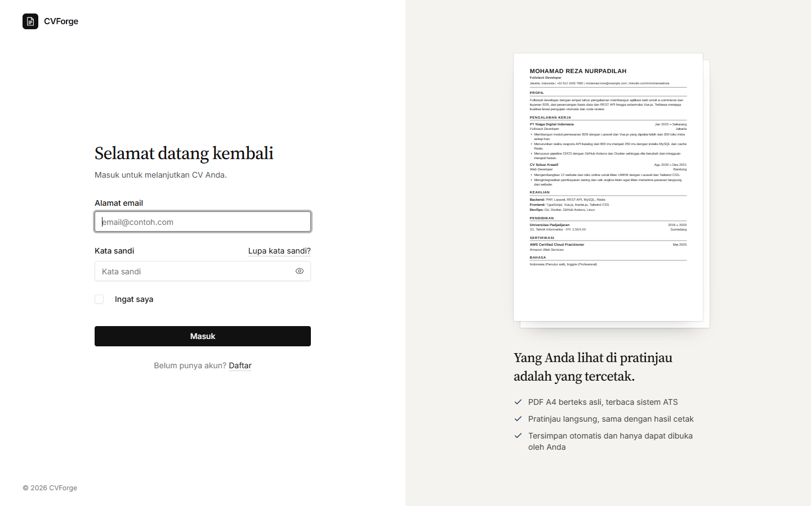
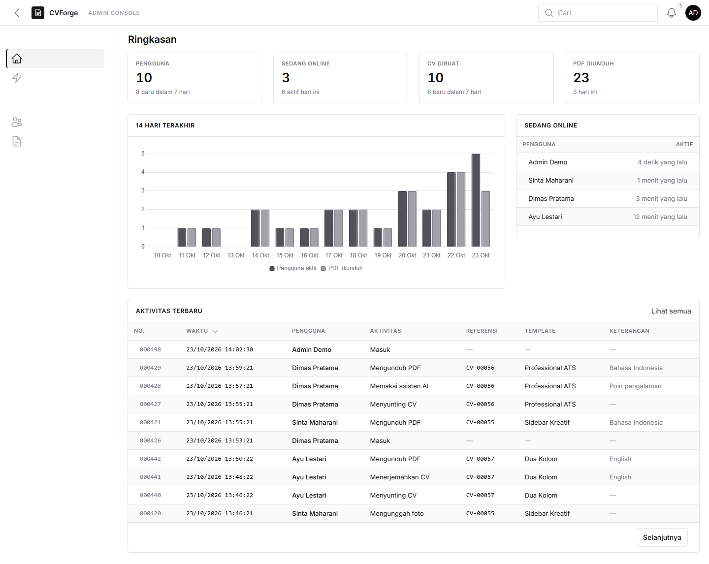
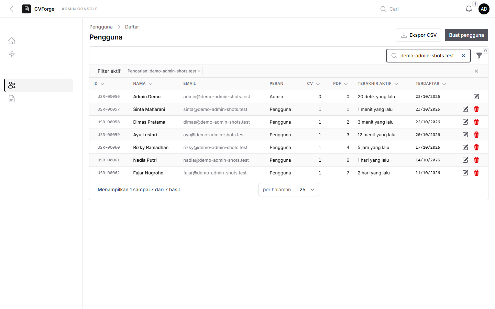
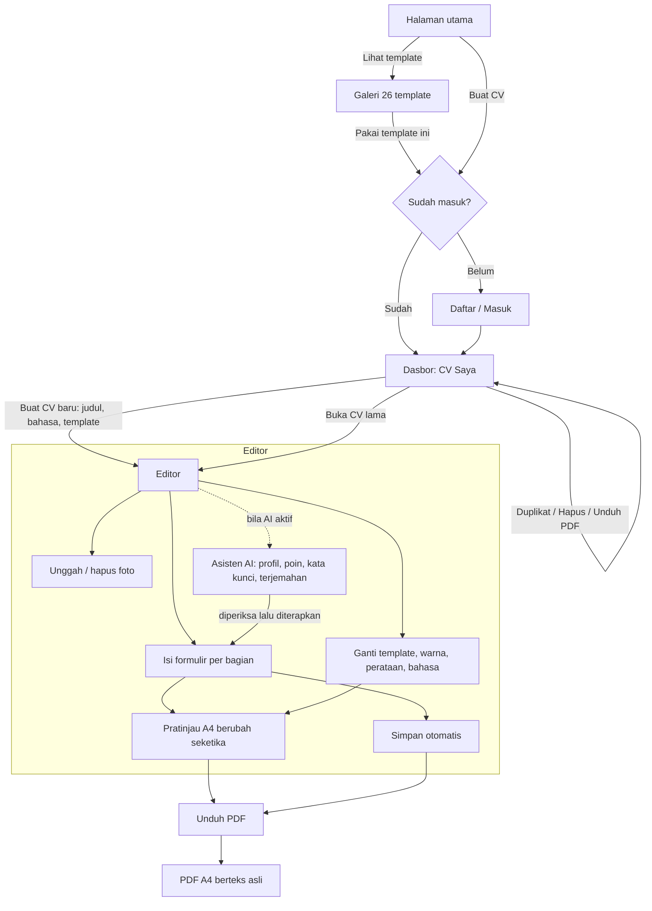
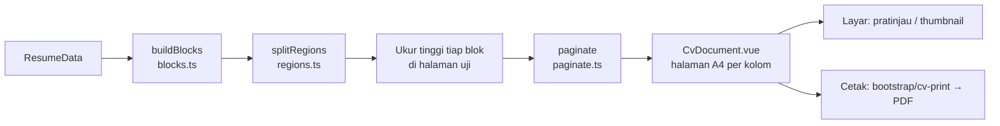
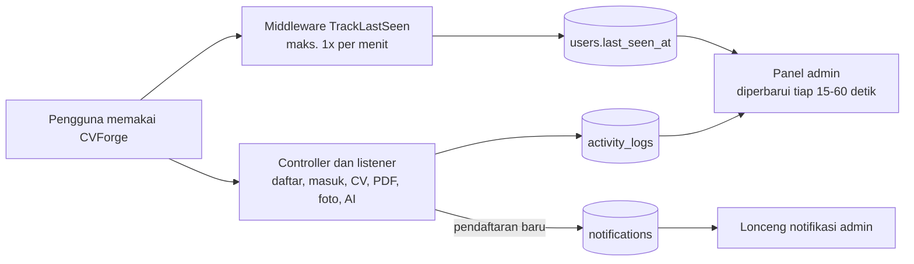

# CVForge — Pembuat CV ATS-Friendly

CVForge adalah aplikasi web untuk menyusun CV profesional dalam format **A4** dan mengunduhnya sebagai **PDF berteks asli** (teks dapat diseleksi dan dicari, sehingga terbaca oleh sistem pelacak lamaran/ATS). Data CV diisi sekali, lalu tampilannya bisa diganti ke salah satu dari **26 template** kapan saja tanpa mengetik ulang.

> Yang Anda lihat di pratinjau adalah yang tercetak: pratinjau di layar dan PDF dirender oleh komponen tata letak yang sama.



---

## Daftar isi

1. [Fitur](#fitur)
2. [Tangkapan layar](#tangkapan-layar)
3. [Teknologi](#teknologi)
4. [Alur pengguna](#alur-pengguna)
5. [Arsitektur dan alur data](#arsitektur-dan-alur-data)
6. [Panel admin dan pemantauan](#panel-admin-dan-pemantauan)
7. [Template](#template)
8. [Instalasi](#instalasi)
9. [Konfigurasi `.env`](#konfigurasi-env)
10. [Akun demo dan data contoh](#akun-demo-dan-data-contoh)
11. [Perintah sehari-hari](#perintah-sehari-hari)
12. [Struktur folder](#struktur-folder)
13. [Panduan pengembang](#panduan-pengembang)
14. [Keamanan dan privasi](#keamanan-dan-privasi)
15. [Pemecahan masalah](#pemecahan-masalah)

---

## Fitur

**Untuk pengguna**

- **Editor dua panel**: formulir di kiri, pratinjau A4 langsung di kanan (bertumpuk di ponsel).
- **Bagian CV lengkap**: data diri dan kontak, foto (opsional), profil singkat, pengalaman kerja, magang, organisasi, pendidikan, proyek, keahlian, sertifikasi, dan bahasa. Setiap entri dapat ditambah, disunting, dihapus, dan diurutkan ulang; urutan bagian juga dapat diatur.
- **Bagian kosong tidak tercetak**, jadi tidak ada judul bagian yang menggantung.
- **26 template**: 20 satu kolom yang ramah ATS dan 6 dua kolom berlabel _Kreatif_. Sebagian berwarna dengan 6 pilihan warna aksen.
- **Contoh CV dari berbagai bidang** di galeri template: akuntansi, keperawatan, pendidikan, pemasaran, teknik sipil, desain, SDM, hukum, farmasi, perhotelan (bahasa Inggris), lulusan baru, dan pengembang perangkat lunak.
- **Ganti template, warna aksen, perataan paragraf (rata kiri/rata kanan-kiri), dan bahasa dokumen** tanpa kehilangan isi.
- **Dua bahasa dokumen** (Bahasa Indonesia dan English): judul bagian dan format tanggal ikut berganti.
- **Pergantian halaman yang rapi**: judul bagian tidak tertinggal sendirian di bawah halaman, satu entri tidak terpotong bila muat di halaman berikutnya.
- **Unduh PDF A4** berteks asli, hasilnya sama dengan pratinjau.
- **Tersimpan otomatis**, plus dasbor untuk membuka, menduplikat, mengunduh, dan menghapus CV.
- **Asisten AI (opsional)**: menyempurnakan profil singkat dan poin pengalaman, mencocokkan kata kunci lowongan, dan menerjemahkan isi CV ke bahasa lain. Asisten tidak mengarang pengalaman, dan setiap hasilnya ditampilkan untuk diperiksa dan disunting sebelum diterapkan.

**Untuk admin** (Filament, di `/admin`)

- **Ringkasan langsung**: jumlah pengguna, yang sedang online, CV dibuat, dan PDF diunduh, plus grafik aktivitas 14 hari. Diperbarui otomatis.
- **Aktivitas terbaru**: siapa melakukan apa dan kapan (mendaftar, masuk, membuat/menyunting/menghapus CV, mengunduh PDF, memakai asisten AI, dan lainnya).
- **Sedang online**: pengguna yang aktif dalam 15 menit terakhir.
- **Notifikasi** di ikon lonceng setiap ada pengguna baru mendaftar.
- **Riwayat per pengguna** di halaman detail pengguna.
- **Ekspor CSV** untuk daftar pengguna dan log aktivitas (mengikuti filter yang aktif).
- Mengelola pengguna (termasuk memberi akses admin) dan template.
- Admin yang masuk lewat `/login` langsung diarahkan ke panel admin.

---

## Tangkapan layar

| Pratinjau template                                           | Dasbor CV                                 |
| ------------------------------------------------------------ | ----------------------------------------- |
|  |  |

| Editor                                 | Masuk                                |
| -------------------------------------- | ------------------------------------ |
|  |  |

| Panel admin: ringkasan                                   | Panel admin: pengguna                                               |
| -------------------------------------------------------- | ------------------------------------------------------------------- |
|  |  |

Contoh hasil PDF: [`docs/contoh-cv-fullstack-developer.pdf`](docs/contoh-cv-fullstack-developer.pdf).

---

## Teknologi

| Lapisan       | Teknologi                                                              |
| ------------- | ---------------------------------------------------------------------- |
| Backend       | PHP 8.3+, Laravel 13, Laravel Fortify (autentikasi)                    |
| Frontend      | Vue 3 + TypeScript, Inertia.js 3, Tailwind CSS 4, shadcn-vue (reka-ui) |
| Build         | Vite (vite-plus), Laravel Wayfinder (route helper bertipe)             |
| Database      | MySQL 8                                                                |
| Panel admin   | Filament 5                                                             |
| PDF           | spatie/browsershot + Puppeteer, headless Chrome/Chromium               |
| AI (opsional) | Anthropic PHP SDK (Claude)                                             |
| Pengujian     | PHPUnit 12, Laravel Pint, PHPStan, vue-tsc                             |
| Font CV       | Arimo, Carlito, Tinos (metrik setara Arial, Calibri, Times)            |
| Font UI       | Inter dan Source Serif 4 (di-bundle, tanpa CDN)                        |

---

## Alur pengguna



Langkah-langkahnya:

1. **Halaman utama**: pengunjung melihat contoh CV, membandingkan template, lalu memilih **Buat CV** atau **Pakai template ini**. Template yang dipilih diingat sampai pengguna selesai mendaftar.
2. **Daftar atau masuk**: akun dibuat dengan nama, email, dan kata sandi.
3. **Dasbor (CV Saya)**: daftar CV dalam bentuk lembar kecil. Tombol **CV baru** membuka dialog untuk memilih judul, bahasa dokumen, dan template. Nama dan email akun diisikan otomatis ke CV baru.
4. **Editor**: isi setiap bagian di panel kiri; pratinjau A4 di kanan langsung berubah. Perubahan tersimpan otomatis beberapa saat setelah mengetik, dan status simpan terlihat di bilah atas.
5. **Atur tampilan**: ganti template, warna aksen (untuk template berwarna), perataan paragraf, dan bahasa dokumen. Isi CV tidak berubah.
6. **Unduh PDF**: editor memastikan semua perubahan (termasuk foto) sudah tersimpan, lalu server mencetak PDF A4.

---

## Arsitektur dan alur data

Isi CV disimpan **terpisah dari tata letak**. Template hanya menentukan cara blok ditampilkan, sehingga satu data dapat dirender oleh 26 template dan menghasilkan pratinjau yang sama dengan PDF.

```mermaid
flowchart LR
    subgraph Browser
        ED[Editor Vue<br/>useResumeEditor] -->|PUT /resumes/id<br/>simpan otomatis| API
        ED --> PV[CvDocument<br/>pratinjau A4]
    end

    subgraph Laravel
        API[ResumeController@update] --> RQ[UpdateResumeRequest<br/>validasi]
        RQ --> SV[SaveResumeContent<br/>transaksi]
        SV --> DB[(MySQL)]
        PDF[DownloadResumePdfController] --> RD[ResumePdfRenderer]
        RD --> PL[ResumePayload<br/>data CV + foto]
        PL --> DB
        RD --> BL[Blade pdf/resume<br/>+ bundel cetak]
        BL --> CH[Browsershot<br/>headless Chrome]
    end

    ED -->|GET /resumes/id/pdf| PDF
    CH -->|application/pdf| ED
```

**Mesin tata letak CV** (dipakai bersama oleh pratinjau dan PDF, di `resources/js/cv`):



1. **`buildBlocks`** memecah CV menjadi blok: header, judul bagian, paragraf, entri, poin, dan baris (keahlian/bahasa). Bagian kosong dilewati.
2. **`splitRegions`** membagi blok ke area halaman: satu kolom, atau untuk template _Kreatif_: area atas, kolom utama, dan kolom samping.
3. Setiap blok **diukur** di halaman uji tak terlihat dengan font dan lebar kolom yang sebenarnya.
4. **`paginate`** menyusun blok ke halaman A4: judul bagian selalu ikut blok berikutnya, entri pendek beserta poinnya tidak dipecah, dan kapasitas halaman pertama boleh berbeda (misalnya di bawah header berfoto).
5. **`CvDocument`** merender halaman. Untuk PDF, komponen yang sama dibundel menjadi `bootstrap/cv-print` dan dicetak Chrome dengan ukuran A4 dan font yang disematkan.

**Model data utama**

| Tabel                                                                                                      | Isi                                                                                    |
| ---------------------------------------------------------------------------------------------------------- | -------------------------------------------------------------------------------------- |
| `users`                                                                                                    | Akun, termasuk penanda `is_admin` dan `last_seen_at`                                   |
| `activity_logs`                                                                                            | Aktivitas pengguna untuk panel admin (tanpa isi CV)                                    |
| `notifications`                                                                                            | Notifikasi admin, mis. pengguna baru                                                   |
| `cv_templates`                                                                                             | Daftar template (slug, nama, deskripsi, urutan, aktif)                                 |
| `resumes`                                                                                                  | Judul, template, bahasa, warna aksen, perataan, urutan bagian, data diri, profil, foto |
| `resume_experiences`                                                                                       | Pengalaman kerja, magang, dan organisasi (dibedakan dengan `type`)                     |
| `resume_educations`, `resume_projects`, `resume_skill_groups`, `resume_certifications`, `resume_languages` | Bagian-bagian CV lainnya                                                               |

**Rute utama** (semua rute CV memerlukan login dan hanya dapat diakses pemiliknya)

| Metode        | URL                                   | Fungsi                                  |
| ------------- | ------------------------------------- | --------------------------------------- |
| GET           | `/`                                   | Halaman utama                           |
| GET           | `/dashboard`                          | Daftar CV                               |
| POST          | `/resumes`                            | Buat CV baru                            |
| GET           | `/resumes/{id}/edit`                  | Editor                                  |
| PUT           | `/resumes/{id}`                       | Simpan isi CV (simpan otomatis)         |
| DELETE        | `/resumes/{id}`                       | Hapus CV beserta fotonya                |
| POST          | `/resumes/{id}/duplicate`             | Duplikat CV                             |
| GET           | `/resumes/{id}/pdf`                   | Unduh PDF (maks. 10 per menit)          |
| POST / DELETE | `/resumes/{id}/photo`                 | Unggah / hapus foto                     |
| POST          | `/resumes/{id}/assist`                | Asisten AI (opsional, dibatasi)         |
| POST          | `/resumes/{id}/translate`             | Terjemahan AI (opsional, dibatasi)      |
| —             | `/admin`                              | Panel admin: ringkasan dan pemantauan   |
| —             | `/admin/activity-logs`                | Semua aktivitas pengguna, dengan filter |
| —             | `/admin/users`, `/admin/cv-templates` | Kelola pengguna dan template            |

---

## Panel admin dan pemantauan

Panel admin ada di `/admin`. Tampilannya putih bersih seperti konsol operasional (WMS): tabel padat bergaris dengan nomor dan kode berhuruf monospace, tanpa warna yang tidak perlu. Gayanya ada di `resources/css/filament/admin/theme.css` dan ikut dibangun oleh `npm run build`.

### Membuat akun admin

Jalankan perintah ini dan isi nama serta kata sandi saat diminta (kata sandi tidak tampil saat diketik):

```bash
php artisan cvforge:admin
```

Bisa juga langsung menyebut email. Bila akun dengan email itu sudah ada, perintah ini menawarkan untuk menjadikannya admin:

```bash
php artisan cvforge:admin nama@domain.com
```

Admin juga dapat memberi atau mencabut akses admin pengguna lain dari menu **Pengguna**. Untuk pengembangan lokal, seeder menyediakan `admin@cvforge.test` (lihat [Akun demo](#akun-demo-dan-data-contoh)).

### Alur pemantauan



### Yang dicatat

| Aktivitas                             | Kapan tercatat                                            | Detail yang disimpan           |
| ------------------------------------- | --------------------------------------------------------- | ------------------------------ |
| Mendaftar                             | Akun baru dibuat (admin juga mendapat notifikasi)         | —                              |
| Masuk                                 | Pengguna masuk                                            | —                              |
| Membuat CV                            | CV baru dibuat                                            | Nomor CV, template             |
| Menyunting CV                         | Simpan otomatis; paling banyak sekali per 30 menit per CV | Nomor CV, template             |
| Menduplikat / Menghapus CV            | Tombol duplikat atau hapus                                | Nomor CV, template             |
| Mengunduh PDF                         | PDF berhasil dibuat                                       | Nomor CV, template, bahasa     |
| Mengunggah foto                       | Foto tersimpan                                            | Nomor CV, template             |
| Memakai asisten AI / Menerjemahkan CV | Hasil AI berhasil dibuat                                  | Jenis tugas atau bahasa tujuan |

**Privasi:** isi CV (nama di CV, pengalaman, judul CV, dan lainnya) tidak pernah dicatat, dan admin tetap tidak dapat membuka isi CV pengguna. Riwayat aktivitas ikut terhapus bila akun pengguna dihapus.

"Sedang online" berarti pengguna membuka aplikasi dalam 5 menit terakhir; daftar di ringkasan menampilkan yang aktif dalam 15 menit terakhir.

---

## Template

| Slug            | Nama             | Kolom | Warna               | Foto                                |
| --------------- | ---------------- | ----- | ------------------- | ----------------------------------- |
| `classic`       | Classic ATS      | 1     | Hitam-putih         | Opsional                            |
| `compact`       | Compact ATS      | 1     | Hitam-putih         | Opsional                            |
| `modern`        | Modern ATS       | 1     | Hitam-putih         | Opsional                            |
| `professional`  | Professional ATS | 1     | Hitam-putih         | Opsional                            |
| `executive`     | Executive ATS    | 1     | Hitam-putih (serif) | Opsional                            |
| `accent`        | Accent ATS       | 1     | Aksen               | Opsional                            |
| `banner`        | Banner ATS       | 1     | Aksen               | Opsional                            |
| `block`         | Block ATS        | 1     | Aksen               | Opsional                            |
| `portrait`      | Portrait ATS     | 1     | Aksen               | Bulat                               |
| `timeline`      | Timeline ATS     | 1     | Aksen               | Bulat                               |
| `gutter`        | Gutter ATS       | 1     | Hitam-putih         | Opsional                            |
| `minimal`       | Minimal ATS      | 1     | Hitam-putih         | Opsional                            |
| `monogram`      | Monogram ATS     | 1     | Aksen               | Opsional; tanpa foto tampil inisial |
| `numbered`      | Numbered ATS     | 1     | Aksen               | Opsional                            |
| `leader`        | Leader ATS       | 1     | Hitam-putih         | Opsional                            |
| `bold`          | Bold ATS         | 1     | Hitam-putih         | Opsional                            |
| `ribbon`        | Ribbon ATS       | 1     | Aksen               | Opsional                            |
| `corporate`     | Corporate ATS    | 1     | Hitam-putih         | Opsional                            |
| `tabbed`        | Tab ATS          | 1     | Aksen               | Opsional                            |
| `elegant`       | Elegant ATS      | 1     | Hitam-putih (serif) | Opsional                            |
| `sidebar`       | Sidebar Kreatif  | 2     | Aksen               | Bulat                               |
| `sidebar-light` | Sidebar Terang   | 2     | Aksen               | Bulat                               |
| `two-column`    | Dua Kolom        | 2     | Aksen               | Bulat                               |
| `split`         | Split            | 2     | Hitam-putih         | Opsional                            |
| `magazine`      | Majalah          | 2     | Aksen               | Bulat                               |
| `folio`         | Folio            | 2     | Hitam-putih         | Opsional                            |

Warna aksen: navy, teal, hijau (forest), merah marun (burgundy), ungu (plum), dan arang (charcoal).

> **Catatan ATS:** template satu kolom paling aman untuk portal lowongan. Template _Kreatif_ tetap berteks asli, tetapi sebagian ATS lama dapat membaca urutan kolomnya kurang tepat, jadi lebih cocok untuk dikirim langsung ke perekrut.

---

## Instalasi

### Prasyarat

- PHP **8.3+** dengan ekstensi `pdo_mysql`, `gd`, `exif`, `mbstring`, `fileinfo`
- Composer 2
- Node.js **20+** dan npm
- MySQL **8**
- Google Chrome/Chromium (untuk mencetak PDF), atau Chrome yang diunduh Puppeteer
- Opsional: [Laravel Herd](https://herd.laravel.com) untuk domain lokal seperti `http://cv.test`

### Langkah

```bash
git clone https://github.com/reza-programer/CV-.git cvforge
```

```bash
cd cvforge
```

```bash
composer install
```

```bash
npm install
```

```bash
cp .env.example .env
```

```bash
php artisan key:generate
```

Buat database kosong `cvforge` di MySQL, lalu sesuaikan `DB_*` di `.env` bila perlu. Setelah itu jalankan migrasi (template ikut dibuat oleh migrasi) dan data contoh:

```bash
php artisan migrate --seed
```

Bangun aset frontend dan **bundel cetak PDF** (`npm run build` menjalankan keduanya):

```bash
npm run build
```

Jalankan aplikasi. Dengan Herd, cukup buka `http://cv.test`. Tanpa Herd:

```bash
composer run dev
```

Lalu buka alamat yang ditampilkan (biasanya `http://127.0.0.1:8000`).

### Chrome untuk PDF

Isi `CVFORGE_CHROME_PATH` dengan lokasi Chrome yang terpasang, misalnya:

- Windows: `C:/Program Files/Google/Chrome/Application/chrome.exe`
- macOS: `/Applications/Google Chrome.app/Contents/MacOS/Google Chrome`
- Linux: `/usr/bin/google-chrome`

Atau kosongkan dan unduh Chrome milik Puppeteer:

```bash
npx puppeteer browsers install chrome
```

Di server Linux tanpa sandbox (misalnya kontainer), set `CVFORGE_CHROME_NO_SANDBOX=true`.

---

## Konfigurasi `.env`

| Variabel                        | Bawaan                     | Keterangan                                                                  |
| ------------------------------- | -------------------------- | --------------------------------------------------------------------------- |
| `APP_URL`                       | `http://localhost`         | URL aplikasi, mis. `http://cv.test`                                         |
| `APP_LOCALE`                    | `id`                       | Bahasa antarmuka                                                            |
| `APP_TIMEZONE`                  | `UTC`                      | Zona waktu, mis. `Asia/Jakarta`                                             |
| `DB_CONNECTION` … `DB_PASSWORD` | `mysql`, `cvforge`, `root` | Koneksi MySQL                                                               |
| `CVFORGE_NODE_BINARY`           | `node`                     | Lokasi Node.js untuk Browsershot (pakai garis miring `/` di Windows)        |
| `CVFORGE_CHROME_PATH`           | kosong                     | Lokasi Chrome/Chromium; kosong = Chrome dari Puppeteer                      |
| `CVFORGE_CHROME_NO_SANDBOX`     | `false`                    | `true` untuk kontainer/server tanpa sandbox                                 |
| `CVFORGE_PDF_TIMEOUT`           | `60`                       | Batas waktu cetak PDF (detik)                                               |
| `ANTHROPIC_API_KEY`             | kosong                     | Mengaktifkan asisten dan terjemahan AI. Bila kosong, fitur AI disembunyikan |
| `CVFORGE_AI_MODEL`              | `claude-opus-5-5`          | Model Claude yang dipakai                                                   |
| `CVFORGE_AI_EFFORT`             | `low`                      | Tingkat usaha model (`low`, `medium`, `high`)                               |
| `CVFORGE_AI_TIMEOUT`            | `60`                       | Batas waktu permintaan AI (detik)                                           |

Jangan pernah meng-commit file `.env`; file ini sudah ada di `.gitignore`.

---

## Akun demo dan data contoh

`php artisan migrate --seed` membuat dua akun lokal dengan kata sandi `password`:

| Email                | Peran                          |
| -------------------- | ------------------------------ |
| `admin@cvforge.test` | Admin (dapat membuka `/admin`) |
| `user@cvforge.test`  | Pengguna biasa                 |

Contoh CV lengkap untuk posisi Fullstack Developer (atas nama Mohamad Reza Nurpadilah) dapat ditambahkan ke akun `user@cvforge.test`:

```bash
php artisan db:seed --class=FullstackExampleSeeder
```

Perusahaan, angka, email, dan tautan pada contoh hanya ilustrasi. Ganti dengan data asli sebelum dikirim.

> Akun dan kata sandi di atas hanya untuk pengembangan lokal. Jangan menjalankan seeder ini di server produksi.

---

## Perintah sehari-hari

| Perintah              | Fungsi                                                 |
| --------------------- | ------------------------------------------------------ |
| `composer run dev`    | Server Laravel, antrean, dan Vite dev server sekaligus |
| `npm run dev`         | Vite dev server saja                                   |
| `npm run build`       | Build produksi + bundel cetak PDF                      |
| `npm run build:print` | Hanya bundel cetak PDF (`bootstrap/cv-print`)          |
| `php artisan test`    | Menjalankan seluruh pengujian PHPUnit                  |
| `composer run test`   | Pint (cek), PHPStan, lalu PHPUnit                      |
| `vendor/bin/pint`     | Merapikan kode PHP                                     |
| `npm run check:fix`   | Lint dan format kode frontend                          |
| `npm run types:check` | Pemeriksaan tipe TypeScript/Vue                        |

Pengujian PDF memerlukan Chrome dan bundel cetak (`npm run build`); bila salah satunya tidak ada, pengujian tersebut otomatis dilewati.

---

## Struktur folder

```text
app/
├── Actions/Resumes/        CreateResume, SaveResumeContent, DuplicateResume
├── Console/Commands/       CreateAdmin (php artisan cvforge:admin)
├── Enums/                  ActivityEvent, ResumeLocale, ResumeAccent, ParagraphAlign, ...
├── Filament/
│   ├── Pages/              Dashboard (Ringkasan)
│   ├── Resources/          ActivityLogs, Users (+ riwayat aktivitas), CvTemplates
│   └── Widgets/            UsageOverview, ActivityChart, OnlineUsers, LatestActivity
├── Http/
│   ├── Controllers/        HomeController, Resumes/* (CRUD, PDF, foto, AI)
│   ├── Middleware/         TrackLastSeen (status online)
│   ├── Requests/Resumes/   UpdateResumeRequest (validasi isi CV)
│   └── Responses/          LoginResponse (admin → /admin)
├── Listeners/              RecordSignIn, RecordRegistration (+ notifikasi admin)
├── Models/                 User, Resume, CvTemplate, ActivityLog, Resume* (bagian CV)
├── Policies/               ResumePolicy (hanya pemilik)
├── Services/               ResumePdfRenderer, ResumePhotos, ResumeAssistant, ResumeTranslator
└── Support/Resumes/        ResumePayload, TranslatableFields
config/cvforge.php          Pengaturan PDF dan AI
database/
├── migrations/             Skema + daftar template
└── seeders/                Akun demo, contoh CV fullstack
resources/
├── css/app.css             Token desain antarmuka
├── js/
│   ├── cv/                 Mesin CV: blocks, regions, paginate, CvDocument, templates/*
│   ├── components/
│   │   ├── editor/         Formulir editor, toolbar, asisten AI
│   │   ├── resumes/        Kartu CV, dialog CV baru, pemilih template
│   │   ├── site/           Header, footer, dan bagian halaman utama
│   │   └── cv/             Pratinjau, thumbnail, lembar CV
│   ├── composables/        useResumeEditor (simpan otomatis)
│   ├── layouts/            AppLayout, AuthLayout
│   └── pages/              Welcome, resumes/Index, resumes/Edit, auth/*, settings/*
└── views/pdf/resume.blade.php   Halaman HTML yang dicetak menjadi PDF
tests/                      Feature dan Unit (PHPUnit)
vite.print.config.ts        Build bundel cetak → bootstrap/cv-print
docs/                       Contoh PDF dan tangkapan layar
```

---

## Panduan pengembang

### Prinsip

- **Data terpisah dari tampilan.** Validasi ada di `UpdateResumeRequest`, penyimpanan di `SaveResumeContent`, dan tata letak di `resources/js/cv`. Template tidak boleh mengubah data.
- **Pratinjau = PDF.** Jangan menambahkan gaya khusus layar ke template; gaya CV hanya berada di CSS template dan `resources/js/cv/styles/document.css`.
- **Ramah ATS.** Hindari teks di dalam gambar, bar keahlian, ikon yang menggantikan teks kontak, dan `opacity` pada teks (urutan teks di PDF dapat berubah).
- **Otorisasi.** Setiap rute CV memakai `ResumePolicy`; pengguna hanya dapat mengakses CV miliknya.

### Menambah template baru

1. Buat folder `resources/js/cv/templates/<slug>/` berisi `<Nama>Template.vue` dan `<slug>.css`. Gunakan template yang sudah ada sebagai acuan (mis. `classic`).
2. Tambahkan slug ke tipe `TemplateSlug` di `resources/js/cv/types.ts`.
3. Daftarkan di `resources/js/cv/templates/index.ts`: komponen, `layout` (`single` atau `columns`), dan `coloured`. Impor CSS-nya di file yang sama.
4. Tambahkan slug ke `CvTemplate::SLUGS` (`app/Models/CvTemplate.php`).
5. Buat migrasi yang menambahkan baris ke `cv_templates` (slug, nama, deskripsi, urutan).
6. Jalankan `npm run build` agar bundel cetak PDF ikut diperbarui, lalu `php artisan migrate`.
7. Periksa CV pendek, panjang (3+ halaman), dan dengan foto di pratinjau dan PDF.

### Menambah bagian CV baru

Tambahkan kolom/tabel lewat migrasi, model dan relasinya, aturan di `UpdateResumeRequest`, penyimpanan di `SaveResumeContent`, payload di `ResumePayload`, tipe di `resources/js/cv/types.ts`, blok di `blocks.ts`, formulir di `components/editor/sections`, dan judul bagian di `format.ts` (ID dan EN).

---

## Keamanan dan privasi

- Foto disimpan di disk privat dan hanya dapat diambil pemilik CV melalui rute yang diotorisasi; foto ikut terhapus saat CV dihapus.
- Unduhan PDF dan permintaan AI dibatasi (rate limit) per pengguna.
- Asisten AI hanya menerima teks CV yang relevan, tidak menulis ke database, dan hasilnya selalu ditinjau pengguna sebelum diterapkan.
- Log aktivitas untuk admin hanya menyimpan jenis aktivitas, waktu, nomor CV, template, dan bahasa, tanpa isi CV. Log tidak dapat diubah atau dihapus dari panel admin.
- Kunci API dan kredensial disimpan di `.env`, bukan di repositori.

---

## Pemecahan masalah

| Gejala                                            | Penyebab dan solusi                                                                                                                        |
| ------------------------------------------------- | ------------------------------------------------------------------------------------------------------------------------------------------ |
| PDF gagal dibuat                                  | Periksa `CVFORGE_CHROME_PATH` dan `CVFORGE_NODE_BINARY`, lalu pastikan `npm run build` sudah dijalankan sehingga `bootstrap/cv-print` ada. |
| Halaman kosong setelah menghentikan `npm run dev` | Hapus file `public/hot`, lalu jalankan `npm run build`.                                                                                    |
| Foto gagal diunggah                               | Pastikan ekstensi PHP `gd` (dan `exif` untuk foto dari ponsel) aktif, serta folder `storage/` dapat ditulis.                               |
| Tombol AI tidak muncul                            | `ANTHROPIC_API_KEY` belum diisi; jalankan `php artisan config:clear` setelah mengubah `.env`.                                              |
| `SQLSTATE[HY000] [2002]`                          | Layanan MySQL belum berjalan atau `DB_*` di `.env` salah.                                                                                  |
